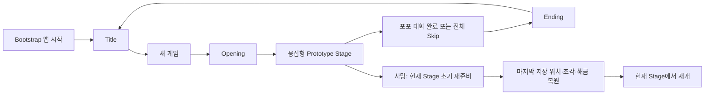

# 씬 흐름과 수동 프리팹 제작 가이드

이 문서는 리소스 병합 후 사람이 새 프리팹을 직접 조립하기 위한 매뉴얼이다. 아래 참조는 실제 V1.5 구현의 필드다. 기존 AI 프리팹을 삭제·재생성·Apply하는 일과 새 리소스 제작은 사람이 한다. 에이전트의 비 Play 검증과 사람이 확인할 실제 움직임·충돌·표시를 구분한다.

## 먼저 알아야 하는 세 가지

Unity의 `.cs` 파일 모두를 오브젝트에 붙이는 것은 아니다. `MonoBehaviour`인 구체 컴포넌트만 Add Component로 붙인다. `BoundView<T>` 같은 추상/generic 기반은 붙이지 않고 실제 HudView/DialogueView 등 구체 View를 붙인다. `ScriptableObject`는 Project 창에 만드는 설정 자산이며, 컴포넌트의 슬롯에 드래그한다. `GameSessionService`, `PlayerBridgeService`, `ServiceLocator`, ViewModel, 인터페이스, 스킬 실행 객체 같은 일반 C# 타입은 조립 코드가 생성하므로 오브젝트에 붙이지 않는다.

Inspector의 **참조 슬롯**에는 Hierarchy의 대상 오브젝트/컴포넌트 또는 Project의 프리팹·설정·이미지를 드래그한다. **수치 슬롯**에는 속도·시간·높이처럼 조절할 값을 입력한다. 도착 위치는 Transform을, CP는 CheckpointMarker를, 씬은 SceneAsset을 드래그한다. 대화는 원본 JSON TextAsset을 연결한 뒤 목록에서 Code를 선택한다. 내부 식별자·Player 빌드용 생성 경로는 사람이 입력하는 슬롯이 아니다.

씬 관리자는 씬의 오브젝트를 연결하는 담당이다. 바닥·장치·Trigger·카메라를 관리자의 자식으로 넣어야 한다는 뜻이 아니다. 각각의 완성 오브젝트는 Hierarchy의 독립된 월드 루트에 놓는다. 개별 프리팹 안에서만 기능상 필요한 부모·자식 관계를 만든다.

## 게임이 어떤 씬을 지나가는가

통합 빌드의 현재 등록 씬은 다음 여섯 개다. 현재 목표는 **기능을 응집한 Stage 하나에서 새 게임→오프닝→플레이→종료 대화→엔딩→타이틀의 진행을 한 번 보여주는 것**이다. Stage 1→2→3 자동 연결은 이번 범위에 넣지 않는다. 이름이 비슷한 과거 테스트 씬은 이 경로의 대체 씬이 아니다.

| 역할 | 실제 씬 | 어디까지 맡는가 |
|---|---|---|
| 앱 시작 | `Assets/_Scenes/Tech_SYM/Architecture/01_Bootstrapper.unity` | 앱 서비스·대화 테이블·출력 카메라1개·옵션·페이드·오디오 |
| 타이틀 | `Assets/_Scenes/Tech_SYM/Architecture/02_Title.unity` | 새 게임·옵션·종료 화면 |
| 공통 플레이 시스템 | `Assets/_Scenes/Tech_SYM/Architecture/03_InGameCore.unity` | 플레이어 생성 담당·HUD·대화·연출·Side/Quarter 리그·추격 담당 |
| Stage 1 | `Assets/_Scenes/Tech_SYM/Architecture/Prototype/1_Stage.unity` | 현재 기능 응집형 첫 스테이지 |
| Stage 2 | `Assets/_Scenes/Tech_SYM/Architecture/Stages/03_2_Stage.unity` | 두 번째 스테이지의 월드·장치·Trigger |
| Stage 3 | `Assets/_Scenes/Tech_SYM/Architecture/Stages/03_3_Stage.unity` | 세 번째 스테이지·추격·포포 |



Opening/Ending은 별도 씬이 아니라 Core의 연출 화면이다. 첫 새 게임 때 Core와 등록 Stage들을 additive로 한 번 로드한다. 현재는 새 게임이 응집형 Prototype Stage를 선택하고 끝까지 한 번 진행한다. Stage 2/3은 각각 직접 진입할 수 있는 등록 씬이며 자동 순차 전환 호출은 없다. 이후 본편 연결에서도 활성 Stage 연결과 루트 활성 상태를 바꾸는 현재 경계를 재사용하며 독립 진입을 보존해야 한다. 사망은 현재 Stage의 초기 배치·장치·수집 객체를 재준비하고 Actor만 새로 만든다. 타이틀 복귀는 한 판 연결·Actor·작업을 해제하며 Core/Stage 씬 인스턴스는 유지한다. Bootstrap 씬은 이미 유지되고 있으므로 카메라를 분리한다고 새로운 거대 DontDestroyOnLoad 부모를 만들 필요가 없다.

실제 출력을 하는 Camera/AudioListener/CinemachineBrain은 Bootstrap에 한 묶음, 한 출력만 둔다. Core의 Side/Quarter는 CinemachineCamera 리그다. 플레이어 prefab에 Camera/Brain/AudioListener/PlayerCameraController를 또 넣지 않는다.

사람이 Stage 씬에서 직접 Play할 때의 Bootstrap 라우팅 훅은 유지한다. 에이전트는 Play 버튼·Play Mode 테스트를 실행하지 않는다. 직접 플레이 판단은 사람이 한다.

## 씬을 만드는 순서와 연결표

1. 리소스를 병합하고 개별 모델의 크기·피벗·Collider 범위를 확인한다. `_Art` 원본 수정은 해당 소유자의 작업이다.
2. 아래 가이드로 플레이어와 껍질, 대표 발판·장치 prefab을 만든다. 기존 AI prefab을 먼저 지울 필요는 없다.
3. Bootstrap/Title/Core의 담당과 화면을 독립 월드 루트로 배치하고 참조를 연결한다.
4. Stage의 바닥·완성 prefab·CP/경로 지점·카메라 구간·해금/추격/데드존 Trigger를 각각 월드에 배치한다.
5. StageService에 그 씬의 실제 참조를 드래그한다. CameraZone/CP/장치의 연결도 각각 설정한다.
6. 편집 검증의 누락 참조·잘못된 물리 동거·잘못된 씬 소속을 고친다. 코드 삭제는 기존 저장 참조를 해소한 뒤 진행한다.
7. 사람이 Play하여 움직임·충돌·저장·재시도·연출을 확인한다. 에이전트의 정적 검사와 사람의 결과는 별도로 기록한다.

권장 월드 배치는 다음과 같다. 표시한 이름은 제작 편의를 위한 예시이며 새 코드가 문자열 이름 검색에 의존해서는 안 된다.

```text
Bootstrap 씬의 독립 루트
  AppManager       [Bootstrapper, AppComposition]
  OutputCamera     [Camera, CinemachineBrain, AudioListener]
  GlobalCanvas     [Canvas / OptionsView / FadeView]
  AudioRoot        [AudioRuntimeHost / AudioSource 자식]
  EventSystem      [UI 입력 담당]

Core 씬의 독립 루트
  CoreManager      [CoreComposition]
  ActorHost        [SessionActorHost]
  GameCanvas       [CoreUiBinding / HUD / 대화 / 연출 화면]
  SideRig          [CinemachineCamera]
  QuarterRig       [CinemachineCamera]
  CameraService    [LevelCameraService]
  ChaseRoot        [ChaseRuntimeDriver / ChaseSwarmPresentation]

각 Stage 씬의 독립 루트
  StageManager     [StageService]          ← 아래 항목의 부모가 아님
  Floor / Cupboard / Oven / Platform...    ← 개별 prefab 루트
  CheckpointStart / CheckpointEnd          ← Marker 또는 기능 Trigger 묶음
  ChaseStart / ChaseGate / PoppoTrigger
  DeadZone... / CameraZone... / UnlockTrigger...
  PathPoint01 / PathPoint02 ...            ← 경로 순서로 연결
```

| 설정할 컴포넌트/자산 | 실제 연결 대상 | 현재 설정 기준 |
|---|---|---|
| ArchitectureInstallation 자산 | Bootstrap/Title/Core 씬 파일, Stage 씬 파일 목록(첫 항목=새 게임의 Prototype) | 경로 문자열 대신 SceneAsset 드래그. 등록 순서·중복·누락 검증. 순차 연결 완료를 의미하지 않음 |
| Bootstrapper | 실제 대화 JSON TextAsset | Dialogue_Code/Sequence가 있는 원본 테이블 하나 사용 |
| AppComposition | Bootstrapper, 설치 자산, AudioRuntimeHost, 출력 Camera, OptionsView, FadeView | GlobalUiRoot 중간 컴포넌트 제거. Camera를 자기 자식으로 강제하지 않음 |
| CoreComposition | SessionActorHost, DialogueView, CinematicHost, 진입 설정, CoreUiBinding, LevelCameraService, ChaseRuntimeDriver, Side/Quarter 리그 | 다른 월드 루트의 실제 컴포넌트를 그대로 연결 |
| SessionActorHost | 만들어 둔 비활성 Player prefab | 생성·제거 단위는 이 prefab 루트. 스폰 위치 기준은 실제 ActorBody |
| CoreUiBinding | HudView, WorldPromptView, World Canvas, 대화/연출 영역 | GameUiRoot 중간 컴포넌트 제거. View 참조를 직접 연결 |
| IntegrationEntrySettings 자산 | Stage 씬 파일, 초기 조각 0..5, 초기 능력 FormChange/Tear | Stage/CP 키 타이핑 제거. 등장 위치는 해당 Stage의 초기 Marker 사용 |
| StageService | 초기 CP Marker, CP 목록, 적 목록, 추격·진행 경로 Transform 배열, 추격 시작 Transform, 퇴로, Stage 음악 | 부모 자식 탐색 제거. 씬 소속으로 조회/검증. 실제 런타임 Actor는 자동 연결 |

Scene의 오브젝트 참조는 같은 씬 안에 연결한다. 여러 씬을 잇는 설치/진입 자산에는 SceneAsset를 넣는다. ScriptableObject에 다른 Scene의 CheckpointMarker를 억지로 저장하지 않는다. 로드 후 실제 Stage가 자기 초기 Marker를 제공한다.

## Player prefab: 가장 먼저 만들어야 할 것

현재 HMS의 `GetComponent`/`RequireComponent`와 PhysX attachedRigidbody 계약 때문에 Facade·Movement·Form·물리는 같은 **ActorBody**에 있어야 한다. 외형과 Collider를 완전히 다른 Rigidbody 형제로 나누면 스킬·접촉·접지가 끊긴다. 이 예외는 빈 prefab 루트 규칙을 없애는 것이 아니라 실제 물리 몸체를 명시하는 것이다.

```text
PlayerRoot  [생성/삭제 단위인 빈 오브젝트, prefab은 비활성으로 저장]
  ActorBody [아래 플레이어 컴포넌트 + Rigidbody + CapsuleCollider]
    VisualRoot [물리 없는 외형 루트]
      NormalVisual [모델, Animator]
      SmallVisual  [작은 모델, Animator]
    CameraAnchor   [카메라가 따라갈 빈 Transform]
    VFX            [표현 리소스]
    SFX            [플레이어 전용 표현 리소스가 있을 때]
```

**ActorBody가 실제 플레이어 위치·물리 Root다.** 빈 PlayerRoot의 Transform은 인스턴스 관리 단위이며, ActorBody가 움직일 때 같이 이동하는 물리 위치 원본이 아니다. 체크포인트·스킬 중심·껍질 복귀는 PlayerFacade가 있는 ActorBody의 현재 월드 위치를 사용한다. VisualRoot를 PlayerRoot 직계 자식으로 빼면 움직이는 ActorBody를 따라가지 않는다.

ActorBody는 월드 Y가 위인 양의 균일 배율로 두고 실제 Root 배율을 유지한다. V1.5 P0076은 Root를 크기 전환마다 다시 scale하라는 규칙이 아니다. Normal/Small Collider 크기를 HMS Form이 바꾸므로 추가 Root scale을 적용해 이중 축소하지 않는다.

| 붙일 위치 | 컴포넌트 | 직접 설정/연결 | 왜 필요한가 |
|---|---|---|---|
| ActorBody | Rigidbody | 동적, Gravity 켬, 회전 고정. 렌더러에 별도 Rigidbody 금지 | CharacterMovement가 실제 이동을 처리 |
| ActorBody | CapsuleCollider | 활성, IsTrigger 끔, Direction=Y. 정상 몸에 맞는 radius/height/center | Form·접지·실제 몸 높이 판정이 같은 Collider 사용 |
| ActorBody | CharacterMovement | 이동·가속·중력·접지 설정 | 물리 이동 원본. 다른 스크립트로 지속 Transform 이동 금지 |
| ActorBody | PlayerFacade | HP 초기/최대 3, Tear/Shrink/Restore 설정 자산 세 개 드래그 | 스킬 실행 객체는 Facade가 생성. PlayerSkill을 Add Component 하지 않음 |
| ActorBody | PlayerSkillController | 별도 슬롯 숫자 입력/스킬 컴포넌트 부착 없음 | Facade의 두 슬롯(폼/눈물) 초기화 사용 |
| ActorBody | PlayerFormController | visualRoot=VisualRoot, debrisPrefab=아래 ShellRoot의 PlayerDebris. normalJumpHeight=3, smallJumpHeight=2. Small capsule은 실제 모델에 맞게 작성 | Q 즉시 Collider 전환·공간 검사·껍질 소유 |
| ActorBody | HeavyState | Normal에서 활성, Small 전환은 Form이 관리 | 압력판 무게 자격. 임의 추가 bool을 만들지 않음 |
| ActorBody | PlayerMovementModeController | Side/Quarter 이동 속도 각각 5. 초기 모드는 첫 Zone과 일치 | 보호 소스 기본 Quarter=3을 그대로 사용하면 V1.5와 다름. 소유 prefab에서 5로 설정 |
| ActorBody | PlayerVisualController | playerVisualRoot=VisualRoot | 몸체·Collider를 돌리지 않고 논리 정면에 맞게 외형만 회전 |
| ActorBody | PlayerInputReader | 하나만 부착 | 입력 읽기. 통합 Host가 E 눈물을 연결 |
| PlayerRoot 또는 ActorBody | GameplayInputRouter | prefab 전체에 하나만 부착. 현재 소유 PlayerRoot는 관리 Root에 부착 | Host가 주입한 Bridge로 방향/Space/Q/E/F 명령 전달. HMS의 같은 GameObject 물리 계약과 구분 |
| ActorBody | PlayerAnimationController | Facade/Movement/Form과 같은 객체 | 표현 선택과 완료 요청 ID |
| ActorBody | PlayerAnimatorOutput | 실제 PlayerAnimationSet 자산 드래그. 필요 시 Animator override | 클립 재생 결과·피격 길이를 공개 계약으로 연결 |
| ActorBody | PlayerDamagePresentation | player=ActorBody Facade, targets=실제 모델 Renderer 배열. visualRoot=VisualRoot, cameraAnchor=CameraAnchor | 피격 표시와 실제 표현 참조. 이름 검색 제거 |

NormalVisual/SmallVisual은 기존 보호 HMS Form이 찾는 이름이다. 각 Animator와 Renderer는 해당 Visual 밑에 두고 Collider/Rigidbody를 넣지 않는다. 이번 HMS 허용은 애니메이션 우선순위·설명과 실제 접지각 읽기 getter의 세 파일 최소 변경이다. 보호 hierarchy 계약 변경 권한은 포함하지 않는다. `PlayerController`, `TestPlayerFunc`, Temporary HUD·테스트 입력 스크립트를 통합 Player에 함께 붙이지 않는다.

Player prefab은 최상위 활성 체크를 **끄고 저장**한다. Host가 의존을 연결한 뒤 켠다. Shell prefab은 반대로 활성으로 저장해야 기존 Form의 생성 조건을 만족한다. 어떤 prefab을 비활성으로 저장해야 하는지 혼동하면 Q가 무효가 된다.

TearSkillDefinition은 비용5/범위3/기절2초, Q의 성공 재사용 간격은1초 기준이다. 실제 설정 자산을 연결하고 준비시간·클립 종료 때문에 게임 판정을 지연하지 않는다. 빈 AnimationClip을 연결해 “실제 애니메이션 검증 완료”라고 기록하지 않는다.

## Shell prefab: 물리 Root 예외를 명시해서 제작

```text
ShellRoot [PlayerDebris, Rigidbody, BoxCollider, HeavyState, 필요 시 PlatformPassenger]
  Render  [껍질 모델/Renderer]
  VFX/SFX [필요한 표현 리소스]
```

ShellRoot는 메시가 없는 물리 Root다. **현재 HMS PlayerDebris는 Rigidbody·BoxCollider·HeavyState를 자기 GameObject에서 찾으며 Remove가 그 GameObject를 파괴한다.** 그 위에 별도 빈 래퍼를 씌우고 아래 Collider에 PlayerDebris만 붙이면 회수 때 래퍼가 남는다. 이 prefab은 물리 컴포넌트 동거 예외를 적용한다. Collider를 별도 자식으로 나누려면 보호 HMS 계약의 추가 변경이 필요하며 이번 세 파일 최소 변경 범위에 포함되지 않는다.

Rigidbody는 동적, Gravity 켬, BoxCollider는 일반 충돌체(IsTrigger 끔), HeavyState 활성, prefab 및 PlayerDebris 활성이다. Form의 debrisPrefab 슬롯에 ShellRoot의 PlayerDebris를 드래그한다. Owner는 생성한 Form이 자동으로 연결한다. Inspector에서 Owner나 플레이어 좌표를 기입하지 않는다.

발판에 껍질이 끼이면 **껍질만** 밖으로 보정하고 Small 플레이어의 HP는 줄이지 않는다. 데드존에 떨어진 껍질은 **같은 OwnedDebris 객체**를 현재 ActorBody 위치로 되돌린다. 이전 속도/각속도를 정리하고 플레이어와의 IgnoreCollision·무게·Small 형태·껍질 소유 관계를 유지한다. 이 동작을 RecoverDebris/Q 성장/새 껍질 생성으로 처리하지 않는다. Actor 종료·재시도 이후의 낡은 Owner는 복귀 대상이 아니다.

## 발판 prefab의 공통 물리 구성

현재 KinematicPlatformMotion은 Root의 논리와 실제 움직이는 자식 Rigidbody를 분리해서 연결한다. PlatformContacts는 그 Rigidbody와 지지 BoxCollider가 있는 **같은 물리 오브젝트**에 둔다. 이 계약에서 Render는 실제 물리 몸체를 따라가야 한다.

```text
PlatformRoot [기믹 컨트롤러, KinematicPlatformMotion]
  Collider   [Rigidbody, BoxCollider, PlatformContacts]  ← 실제 움직이는 몸체
    Render   [모델/Renderer]                           ← Collider와 같이 이동
  StartPoint [움직이는 Collider의 자식으로 넣지 않음]
  EndPoint   [움직이는 Collider의 자식으로 넣지 않음]
```

Render를 PlatformRoot의 형제로 놓아야 하는 리소스라면 별도 표현 연결 구현이 필요한 구성이다. 기본 제작에서는 위처럼 실제 몸체 아래 둔다. 빈 Root는 작성 기준과 논리 책임, Collider는 실제 물리 이동 기준이며 목표 Point는 그 이동의 영향을 받지 않는다. 완성 prefab의 Root를 씬에 배치하면 몸체와 기준점이 함께 배치된다. 실행 중 Collider가 목표로 이동할 때 Point까지 따라가지 않는다.

`KinematicPlatformMotion.physicsBody`에 Collider의 Rigidbody, `platformContacts`에 같은 Collider의 PlatformContacts를 드래그한다. Rigidbody는 Kinematic, Gravity 끔, 일반 BoxCollider다. Motion은 실제 실행에 Interpolate/ContinuousSpeculative와 탑승 처리를 설정한다. 같은 Body에 HMS MovingPlatform·PlatformRigidbodyMovement·다른 Transform Tween을 함께 넣지 않는다.

| 종류 | Root에 추가할 기능 | 직접 연결/수치 | 만들지 않을 것 |
|---|---|---|---|
| 고정 발판·찬장 선반 | 추가 기능 스크립트 없음 | Render+고정 Collider. 필요 시 충돌 레이어 설정 | 단순 바닥을 위한 StaticPlatformService |
| 왕복 이동 발판 | LinearShuttlePlatform + Motion | startPoint/endPoint Transform, moveSpeed(m/s) | 목표 좌표 travelOffset 타이핑 |
| 부유 발판 | FloatingPlatform + Motion | 눌림 깊이·반동 높이·시간·곡선 수치 | 같은 착지 중 두 번째 반동·별도 Rigidbody writer |
| 생성·소멸 발판 | PeriodicPlatform. 실제로 이동하는 경우만 Motion 추가 | supportCollider=실제 비 Trigger BoxCollider. 고정 발판의 motion 슬롯은 비움. 표시5/소멸2/형성3초 초기값, 시작 위상·깜빡임 | OnValidate로 사람 수치를 고정. Render만 밀어내는 사망 표현 |
| 붕괴 발판 | ShatteredPlatform + 지지 Body의 PlatformContacts | visual=외형 Transform, supportCollider=지지 Collider, collapseAnimator=실제 붕괴 Animator, physicalContacts=실제 Collider의 Contacts. 경고 초기1초 | Small/껍질만으로 붕괴, 같은 시도 자동복구 |
| 압력판 | PressurePlatePlatform + Motion | 눌림 깊이(m), 이동시간(초). 연결의 원본은 아래 Linked의 pressurePlate 한 곳 | Normal과 Small을 무게 bool 두 개로 복제 |
| 압력판 연동 발판 | PressureLinkedPlatform + Motion | pressurePlate=실제 압력판, startPoint/targetPoint, returnSpeed | 플레이트 위치/ID 타이핑 |

연동 발판의 `pressurePlate`에 실제 압력판 컴포넌트를 드래그하면 된다. 압력판의 역방향 `linkedPlatform` 슬롯은 제거됐다. Plate는 눌림 상태·시간, Linked는 연결된 발판의 이동·복귀를 소유한다. 같은 연결을 양쪽 Inspector에 중복 입력하지 않는다.

생성·소멸 형성 중에는 Collider가 없다. 나타나는 순간 또는 실제 이동 중 겹침을 검사한다. 상부 정상 착지는 유지한다. 실제 몸 높이 내부 침투가 1/4 미만이면 몸체 위치와 지지 접촉을 정상 착지로 보정하고, 1/4 이상(정확히1/4 포함)이면 물리 몸체를 위로 밀어내며 사망한다. 사람의 테스트에는 경계 바로 아래/동일/바로 위, Small, 이동 중, 정상 상부 착지, 껍질을 각각 포함한다.

## 기름·열원·오븐 문·트레이·서랍

| 오브젝트 | 컴포넌트와 위치 | 연결·설정 |
|---|---|---|
| 기름 | 실제 접촉 Collider를 가진 물체의 HMS OilSurface | 기존 공개 조합 사용. 미끄러짐은 겹쳐도 합산하지 않고 나간 뒤 초기3초, 이동 담당의 효과 경로 사용 |
| 켜진 화구/냄비 | Root의 DamageFloorPlatform, 실제 몸체의 PlatformContacts/일반 Collider | `physicalContacts`에 실제 비 Trigger BoxCollider와 같은 오브젝트의 PlatformContacts를 드래그한다. 이 몸체는 DamageFloorPlatform과 같은 오브젝트이거나 그 자식이어야 한다. 공통 Host/Bridge 피격 세기를 사용하고 켜짐/꺼짐은 배치로 설정한다 |
| 오븐 문 | Root의 OvenTrayObject+Motion+InteractionPromptAnchor, 실제 이동 몸체는 발판 공통 구성 | operationMode=Hinge. closedPose/openPose Transform으로 회전 자세 연결 |
| 트레이 | 같은 구성 | operationMode=Translate. 닫힘/열림 Transform, moveDuration. 이동 중 탑승자도 이동 |
| 서랍3개 | 위 장치 prefab을 독립 인스턴스3개 | 각자의 닫힘/열림 위치·Collider 범위·InteractionPoint 연결. 공용 상태로 세 개를 같이 토글하지 않음 |

힌지 문에서 실제 Rigidbody의 피벗이 회전축에 있어야 한다. 문 모델과 Collider는 그 회전축 기준으로 놓는다. `OpenPose`/`ClosedPose`는 움직이는 몸체의 자식으로 넣지 않는다. 반대로 PromptPoint/InteractionPoint는 실제 손잡이/조작부를 따라 움직이는 몸체의 자식으로 둔다. 목표 지점과 현재 조작 지점의 부모 기준이 다르다. 실제 제어는 Motion 한 곳이며 Animator Root Motion으로 몸체 위치를 또 움직이지 않는다.

F는 장치 토글과 표현 요청을 동시에 수락하고 이동 중 추가 토글을 막는다. 플레이어 이동·점프를 애니메이션 끝까지 막는 구성으로 만들지 않는다. 서랍·트레이·문마다 새 Service/상속 클래스를 추가할 필요는 없다.

## TearFragment prefab: Render와 Trigger가 같이 움직이게

```text
TearRoot          [전체 이동 단위]
  Render          [눈물 모델/Renderer]
  Collider        [Trigger Collider + TearFragment]
```

현재 TearFragment는 Collider가 있는 오브젝트에서 Trigger 콜백을 받으므로 Collider 자식에 둔다. `pickupRoot`에는 TearRoot를, `presentationVisual`에는 Render를 드래그한다. Render 밑에 Rigidbody/Collider를 중복 추가하지 않는다. 플레이어의 Rigidbody가 Trigger와 접촉할 수 있게 충돌 레이어를 설정한다.

회전·상하 이동 대상은 **TearRoot 전체**이고 Render·Collider가 함께 움직인다. Sensor나 Render만 움직이는 추가 Tween을 넣지 않는다. `rotationDegreesPerSecond`/`bobHeight`/`bobSeconds`는 직관적 수치로 남긴다. 센서와 메시가 다른 곳에 있지 않아야 한다. 수집량은1, 최대5일 때 수집 객체를 남기고, retry는 같은 원본 Root·Sensor를 초기 위치·활성 상태로 복원한다.

## 일반 적 prefab

```text
EnemyRoot [EnemyActor]
  Render  [모델/Animator; 별도 게임 규칙 없음]
  Collider [BoxCollider Trigger + EnemyContactSensor]
  PatrolStart / PatrolEnd [움직이는 실제 적 Root의 자식으로 두지 않음]
```

적 Root를 실제로 이동시키므로 경로 Point는 **씬의 별도 월드 루트** 또는 함께 배치되지만 실행 중 움직이지 않는 작성용 묶음에 둔다. EnemyRoot 아래에 그대로 두면 적이 이동할 때 목표도 이동한다. 프리팹 자체에 둘 필요가 있을 때는 외곽 작성 Root/내부 이동 Actor로 명시적으로 나누고 대상 참조가 고정된다는 것을 검증한다. 기본 가이드는 씬의 월드 Point를 드래그하는 방법이다.

EnemyActor.definition에 EnemyDefinition 자산, body에 실제 Collider의 BoxCollider, EnemyContactSensor.owner에 EnemyRoot의 EnemyActor를 드래그한다. Root는 월드 Y 위/무회전/단위 배율 기준이며 지형 레이어를 설정한다. 일반 적의 Root·조상·자식에 Rigidbody를 넣지 않는다. EnemyActor가 Root Transform을 움직이고 Player의 동적 Rigidbody로 Trigger 접촉한다. Body는 Root 직계 자식이며 localPosition=0, 월드 무회전·단위 배율을 유지한다.

순찰 적은 patrolStart/patrolEnd에 실제 고정 지점을 연결하고 X/Y 방향을 선택한다. Stationary 종류의 정지 적은 이 두 슬롯을 비운다. 속도·첫 대기·지형 검색 거리·표면 간격은 수치로 남긴다. target PlayerFacade는 활성 Stage 연결 시 현재 Actor가 자동으로 주입되며 과거 Actor를 프리팹에 저장하지 않는다.

상태/기절은 EnemyActor, 접촉 피해는 EnemyContactSensor가 소유한다. 이 책임으로 대체된 EnemyStateMachine·EnemyCombat은 삭제했다. EnemyMotor는 지형·실제 이동 책임이 있어 내부 객체로 유지한다. 적 HP/죽음/드롭 기름/Chase·Return 상태를 추가하지 않는다.

## CP·카메라 구간·해금·추격·데드존 Trigger

Trigger 콜백이 필요한 Collider와 StageTrigger/CameraZoneTrigger는 같은 센서 오브젝트에 둔다. 빈 Root를 쓰면 그 아래 Sensor에 BoxCollider(IsTrigger 켬)와 콜백 컴포넌트를 둔다. 관리자는 Sensor의 참조를 연결할 뿐 부모가 아니다.

| 기능 | 붙일 컴포넌트 | 사람이 연결할 대상 |
|---|---|---|
| 작성용 CP | CheckpointMarker | respawnPoint=실제 ActorBody 중심을 놓을 Transform, initialCameraZone=같은 씬 실제 CameraZoneTrigger. StageService의 initialCheckpoint와 CP 목록 연결 |
| 접촉 CP | StageTrigger(Checkpoint) + BoxCollider Trigger | stage=같은 씬 StageService, checkpoint=실제 Marker. 위치 저장은 접촉 당시 플레이어 현재 위치이며 Marker로 덮어쓰지 않음 |
| 해금 | StageTrigger(Unlock...) + BoxCollider Trigger | stage, FormChange/Tear 선택, 해당 대화 선택. 이미 완료한 안내 대화는 반복하지 않음 |
| 일반 대화/포포 | StageTrigger 해당 종류 + BoxCollider Trigger | stage와 테이블에서 고른 대화. 완료/Skip만 종료 대화로 인정, 취소는 불인정 |
| 다음 Stage 연결 | 이번 프로토타입에는 새 전환 Trigger를 만들지 않음 | 미래 본편 작업 때 현재 Stage 선택/해제와 등록 씬 경계를 재사용. 각 씬 직접 진입도 유지 |
| Side/Quarter 구간 | CameraZoneTrigger + 구간 Collider | Trigger에서 모드 선택. Side와 Quarter 모두 같은 씬의 고정 alignmentPoint Transform을 필수 연결. Side만 해당 월드 Z로 정렬하며 Quarter는 Z 정렬에 쓰지 않음 |
| 추격 시작 | StageTrigger(Chase) + 실제 시작선/센서 | Stage의 chaseStartPoint/waypoints와 실제 퇴로 연결. 몸 전체 통과 확인→저장 성공→추격/문 닫힘 |
| 추격 퇴로 | ChaseRetreatGate | 실제 일반 BoxCollider blocker 드래그. 문을 닫아 아직 걸친 플레이어를 끼우지 않음 |
| 데드존 | StageTrigger(Fall) + 실제 범위를 가진 BoxCollider Trigger | 통합 Stage에서는 stage, 독립 씬에서는 independentHost=현재 SessionActorHost 연결. Player는 즉시 사망 복귀, 껍질은 현재 Player 위치로 반환 |

Marker 아래 RespawnPoint를 실제 몸체 중심에 배치한다. 예전 bodyOffset=(0,1.03,0) 수기 좌표는 제거됐다. 사람은 다른 캐릭터 높이에 맞춰 이 Point를 눈으로 옮길 수 있다. Trigger 접촉 저장에는 이 Point가 쓰이지 않는다.

Scene의 CP 개수를 새 규칙으로 고정하지 않는다. 현재 작성된 시작/끝 Marker 구성을 이관하며 V1.5의 실제 새 CP 접촉 저장을 허용한다. 추격 직전 저장은 별도 물리 Marker/월드 저장 ID를 추가할 필요 없이 수락 직전 현재 위치·조각·해금으로 한다. 마지막 물리 CP 재접촉 억제와 추격 전 저장을 혼동하지 않는다.

CameraZoneTrigger의 모드·alignmentPoint를 작성하고 CheckpointMarker의 initialCameraZone에 실제 Trigger를 연결한다. 내부 CameraZoneData는 실행용 값이며 Add Component나 Project 자산이 아니다. 내부 CameraZoneData/Request는 Trigger가 만든 실행 값이며 사람에게 ID/Offset을 쓰게 하지 않는다. 주 카메라 출력 Transform은 CinemachineBrain 한 곳만 쓰고 Side 정렬은 실제 ActorBody를 대상으로 한다. 구간 Marker를 Actor의 자식으로 둬 목표가 함께 움직이게 하지 않는다.

## 메모·HUD·대화·연출 화면

화면의 부모 Canvas 안에서 UI 요소가 계층을 갖는 것은 정상이다. 모든 Button을 월드 루트로 흩으라는 요구가 아니다. 완성된 Canvas/화면 오브젝트가 씬 관리자의 자식으로 종속되지 않도록 한다.

| 화면/월드 오브젝트 | 컴포넌트 | 연결할 실제 요소 |
|---|---|---|
| 월드 메모 Root | MemoObject, MemoModel, InteractionPromptAnchor | memoModel/이미지 Sprite, MemoUIController. promptPoint/interactionPoint Transform. 수동 memoID 대신 실제 Model 참조/자동 식별 |
| 메모 화면 담당 | MemoUIController | screenRoot RectTransform, viewPrefab MemoView |
| 메모 화면 prefab | MemoView | 메모 Image. memoImage=실제 Image, scaleRoot=확대할 RectTransform, duration=초. UIScaleTween은 삭제돼 별도 부착하지 않음 |
| HUD | HudView | group=CanvasGroup, heartImages=서로 다른 Image 3개, heartSprite=실제 Sprite, fragmentCount=TMP, formCard/tearCard=Q/E CanvasGroup. 선택적 health/fragments/abilities는 텍스트 표시용 |
| 월드 F 안내 | WorldPromptView | CanvasGroup, RectTransform, TMP. 대상 선택을 여기서 다시 하지 않음 |
| 옵션 | OptionsView | 닫기/타이틀 Button, Master/Music/SFX Slider, 음량 TMP, 실제 오류 표시가 있을 때 TMP |
| 타이틀 | TitleView + TitleUiRoot | 새 게임/종료/옵션 Button, TitleUiRoot.view |
| 페이드 | FadeView | 화면 전체 cover CanvasGroup |
| 대화 | DialogueView | root/log CanvasGroup, 화자/본문/Auto/로그 TMP, 진행 표시, Panel/Auto/History/Close Button, ScrollRect, 별도의 전체 Skip Button |
| 연출 | CinematicHost + CinematicView | catalog의 실제 원화/문구/컷 목록, View의 RawImage/TMP/Skip/CanvasGroup/Viewport |

HUD의 상태는 ViewModel이 받아 표시한다. 사람은 HP·능력 해금 상태를 화면 컴포넌트에 따로 복제하지 않는다. 미해금 아이콘도 표시하되 음영으로 구분한다. 실제 하트 리소스가 연결되기 전에는 기존 HudIconGraphic 삭제를 완료할 수 없다. 사람의 Image/Sprite 이관 후 해당 소스와 참조를 제거한다.

메모만 자기 월드 정지를 소유하고 F로 열고 닫는다. 대화/로그는 자체 월드 정지가 없다. Options는 월드와 표시 시계를 정지한다. 일반 대화의 Completed/Skipped 장부는 한 판 동안 유지하며 이미 끝낸 일반 안내는 다시 열리지 않는다. **최종 포포 Escape 대화만** 재접촉·재시도 후 새 회차를 허용하는 2번 예외를 적용한다. 취소는 완료가 아니며, CP 능력 복원 때문에 장부를 지우지 않는다. 현재 Stage·Trigger·대화 선택·Actor 세대·Round·Session이 여전히 같고 Completed/Skipped일 때만 Ending을 한 번 예약한다. 낡은 콜백·취소·같은 프레임 사망/포획은 Ending으로 진행하지 않는다.

CinematicCatalog는 순서대로 실제 컷을 넣고 초기 표시시간4초를 쓴다. 컷 순서나 개수를 코드에서 고정하지 않는다. 연출 중 클릭으로 다음 컷 진행을 추가하지 않는다. 전체 Skip 또는 마지막 컷 완료는 Flow가 다음 상태로 진행한다.

## 기존 컴포넌트를 옮길 때의 대응표

이 표는 기존 AI prefab을 새 사람이 만든 prefab으로 바꿀 때의 대응표다. HudIconGraphic 외 22개 소스는 C# 호출과 저장 GUID 소비를 이관한 뒤 삭제했다. 기존 prefab 파일은 삭제하지 않았다.

| 이전 연결 | 새 조립에서 사용할 것 | 사람/에이전트가 해소할 참조 | 삭제 선행 조건 |
|---|---|---|---|
| GameUiRoot + CoreUiBinding | CoreUiBinding 한 개 | HUD/Prompt/Canvas/Dialog/Cinematic mount를 직접 연결 | 기존 UI prefab/씬의 GameUiRoot GUID 제거 |
| GlobalUiRoot + AppComposition | AppComposition | OptionsView/FadeView 직접 연결 | 기존 GlobalUI prefab·Bootstrap의 GUID/호출 제거 |
| UIScaleTween + MemoView | MemoView | 확대 시간/자기 Tween 설정 이관 | MemoView prefab의 별도 컴포넌트 제거 |
| HudIconGraphic | UI Image + 실제 하트 Sprite | HudView.hearts를 새 Image들로 연결 | 실제 리소스 병합·표시 소비·GUID 참조 해소 |
| ActorFallGuard | 실제 데드존 Volume의 StageTrigger(Fall) | 각 Stage/독립 씬에 실제 DeadZone과 Host/Stage 연결 | 기존 Player prefab 참조 제거, 기존 낙사 기능 보존 |
| EnemyStateMachine/EnemyCombat | EnemyActor/EnemyContactSensor | 컴포넌트 추가 대상이 아님; 내부 생성/메서드 호출 이관 | C# 호출 0 및 적 초기 재준비/기절/피해 유지 |
| GameEventBus/EventContracts | Flow Retry 명령 콜백·StageService.Entered | prefab에 붙이는 타입 아님; 조립자 인자/구독 이관 | 생성·등록·Dispose·소비 0 |
| AI Builder 메뉴12개 | 이 가이드에 따른 사람이 직접 조립 | Build/진입 코드의 builder 목록 참조 제거 | Editor 호출 0. builder를 실행해서 prefab을 재생성하지 않음 |

정확히 어떤 기존 자산이 각 GUID를 쓰는지는 [스크립트 필요성 및 삭제 계획](<스크립트 필요성 및 삭제 계획.md>)의 삭제별 참조표에서 확인한다. 현재 삭제 대기는 HudIconGraphic이다. 실제 하트 리소스와 Image 3개를 연결하고 구형 표시의 모든 소비를 해소한 뒤 해당 소스·meta를 삭제한다. 화면에 남은 Q/E/조각 아이콘의 구형 Graphic 소비도 함께 전환해야 한다.

현재 필드의 한국어 이름·실제 타입·Tooltip은 [Inspector 연결 전환 명세](<Inspector 연결 전환 명세.md>)에서 찾는다. 최종 import·build·기계 검증과 사람이 확인할 실제 플레이 범위는 [테스트 및 검증 항목](<테스트 및 검증 항목.md>)에 기록한다.


## 실제 설정 자산부터 만드는 방법

Project 창의 Create 메뉴로 만드는 자산과 Add Component로 붙이는 컴포넌트를 구분한다. 기존 자산을 재사용할 때도 아래 실물 참조를 확인한다.

| Create 메뉴 | 만든 뒤 어디에 연결하는가 | 사람이 작성할 내용 |
|---|---|---|
| Cooked/Architecture Installation | AppComposition의 씬 설치 설정 | 부팅·타이틀·공통 씬과 Stage 목록에 실제 SceneAsset 드래그. 첫 Stage는 Prototype |
| Cooked/Integration Entry Settings | CoreComposition의 초기 진입 설정 | 등록된 각 Stage SceneAsset, 초기 조각 0~5, FormChange/Tear 선택 |
| Cooked/Audio/Cue Catalog | AudioRuntimeHost의 소리 목록 | 용도 선택·실제 AudioClip·음량. 음악/효과음 종류는 용도로 결정된다. 중복 용도/필수 누락 금지 |
| Cooked/Chase Definition | ChaseRuntimeDriver의 추격 설정 | 추격 속도·포획 거리·가속 설정. 실제 경로는 StageService의 Transform 목록 |
| Cooked/Cinematics/Catalog | CinematicHost의 연출 목록 | Opening/Ending별 실제 Texture·문구·표시시간을 순서대로 작성 |
| Cooked/Memo Model | MemoObject의 메모 원본 | 실제 메모 Sprite |
| Tech SYM/Enemy Definition | EnemyActor의 설정 자산 | Stationary/Patrol 종류·이동 속도·첫 대기. 기름 적은 기존 OilSurface 조합 사용 |
| Player/Animation Set | PlayerAnimatorOutput | Normal/Small 실제 클립. Interaction·Knockback·Dead 포함 |
| Skills/Tear, Skills/Shrink, Skills/Restore Form | PlayerFacade의 세 Skill Definition 슬롯 | Tear 비용5/반경3/기절2초 등 실제 Inspector 설정. 스킬 실행 객체를 붙이지 않음 |

AudioRoot에 AudioRuntimeHost를 붙이고 서로 다른 실제 AudioSource **정확히10개**를 배열 순서대로 연결한다. 인덱스0/1은 음악 교차 재생, 2는 UI, 3은 전환, 4~9는 월드 효과음 채널이다. AudioSource의 Play On Awake는 끈다. Listener는 출력 카메라 한 개다. AudioService·음악 보간 driver는 Host가 생성하므로 직접 붙이지 않는다. 미사용 sfx.shell/sfx.escape Catalog Entry는 제거했으며 wav 원본을 지우지 않았다.

Audio 소리 목록의 실제 타입은 `AudioCueCatalog`다. AudioRuntimeHost.catalog에 드래그하며 용도·실제 AudioClip·음량을 설정한다. 음악/효과음 종류는 선택한 용도에서 결정한다. 연출 목록의 실제 타입은 `CinematicCatalog`다. CinematicHost.catalog에 드래그하고 Opening/Ending별 컷 배열에 실제 Texture와 하단 문구를 순서대로 연결한다. 두 타입 모두 Project 설정 자산이며 GameObject에 Add Component로 붙이지 않는다.

## 추격 prefab과 Stage 경로

```text
ChaseRoot [ChaseRuntimeDriver, ChaseSwarmPresentation]
  Render [표현만 담당하는 모델/Renderer]
```

ChaseRuntimeDriver의 추격 설정에 ChaseDefinition, 무리 표현에 같은 Root의 ChaseSwarmPresentation을 연결한다. ChaseSwarmPresentation의 무리 외형에는 자기 Root의 **엄격한 자식 Render**를 연결한다. 자기 Root·외부 오브젝트·Collider/Rigidbody가 있는 외형은 거절한다. 추격 포획은 ChaseModel의 경로 진행으로 판정하고 렌더 메시의 흔들림을 충돌 위치로 사용하지 않는다. 경로 Marker는 Render·ChaseRoot의 자식으로 두지 않는다.

StageService의 추격 경로와 진행 경로 배열은 실제 진행 순서대로 드래그한다. 추격 시작 지점과 퇴로를 연결한다. Start 센서 전신 통과→퇴로에 걸친 몸 없음→현재 ActorBody 위치·조각·해금 저장 성공→추격 수락→문 닫힘 순서다. 실패한 시작 요청은 다시 유효 접촉을 받을 수 있어야 한다.

## 바닥과 붕괴 외형의 중요한 차이

고정 발판은 Collider로 지지하고 별도 이동 스크립트가 필요 없다. 고정 붕괴 발판은 빈 Root의 ShatteredPlatform, Support 자식의 BoxCollider와 PlatformContacts, 물리 없는 Visual 자식과 Animator로 만든다. visual/supportCollider/collapseAnimator/physicalContacts를 각각 연결한다. 경고 Shake는 Animator가 없어도 외형을 움직이므로 Marker를 Visual 밑에 넣지 않는다. Root의 정적인 형제 Marker는 사용할 수 있다. 정상 플레이어 접촉이 경고를 시작하고 Small/껍질만의 접촉은 붕괴를 시작하지 않는다. 재시도에서 초기 상태로 복원한다.

기름은 실제 센서 GameObject 한 곳에 **BoxCollider + HMS OilSurface**를 붙인다. OilSurface는 자기 BoxCollider를 Trigger로 사용한다. 플레이어 ActorBody에 CharacterSlipperyEffect를 붙인다. 이동 책임을 별도 Tween으로 복제하지 않는다. 퇴장 뒤 기본3초 효과이며 중첩으로 합산하지 않는다.

## 센서를 만들고 실제 Stage를 연결하는 순서

1. 독립 월드 루트 아래 Sensor에 BoxCollider와 StageTrigger를 함께 붙이고 Is Trigger를 켠다.
2. 소속 스테이지에 같은 씬 StageService를 드래그하고 요청 종류를 선택한다. Checkpoint는 실제 Marker, UnlockForm/UnlockTear는 필요할 때 안내 대화를 선택한다.
3. 대화 선택에서 Bootstrapper가 사용하는 실제 JSON TextAsset을 연결하고 드롭다운에서 Code를 고른다. Dialogue는 일반 대화, **Escape(값7, 포포 도착)**가 최종 대화다. Dialogue 종류를 포포 대신 사용하면 Ending 흐름이 연결되지 않는다.
4. 체크포인트와 포포 도착은 '한 시도에 한 번' 값과 관계없이 재접촉 규칙을 따른다. 같은 체류에서 수락은 한 번이며 완전히 나간 뒤 다시 요청한다. CP 저장 서비스는 마지막 Marker 재접촉을 거절하고 A→B→A에서는 새 현재 위치·조각·해금을 저장한다. 포포 최종 대화만 일반 Completed/Skipped 장부를 보존한 새 회차를 허용한다. 데드존은 실제 몸체별 중복을 막고 다른 종류는 기존 once 설정을 따른다. Retry는 센서의 체류 기록을 초기화한다. 기존 CP8개와 포포2개 센서의 once=1을 그대로 사용할 수 있다.
5. 통합 데드존은 StageTrigger의 요청 종류=Fall, 소속 Stage를 연결한다. 독립 테스트 씬은 stage를 비우고 independentHost를 같은 씬 Host에 연결한다. 임의 killHeight 좌표 대신 실제 레벨 아래 Volume 크기를 배치한다.
6. Side와 Quarter 카메라 센서는 CameraZoneTrigger+BoxCollider를 함께 붙이고, **두 모드 모두 alignmentPoint에 같은 씬의 고정 Transform을 연결한다.** 슬롯을 비우면 카메라 요청을 만들 수 없다. Side는 이 지점의 월드 Z로 플레이어를 정렬하고 Quarter는 Z 정렬을 수행하지 않는다. 정렬 지점은 움직이는 몸체/Render 밖에 둔다. 초기 CheckpointMarker는 실제 시작 카메라 구간을 연결한다.

CP의 respawnPoint는 **첫 진입 기본 배치**다. 접촉 저장은 당시 ActorBody 월드 중심과 조각·해금 세 항목을 원자 저장한다. 같은 물리 Marker 재접촉은 저장을 갱신하지 않는다. 첫 유효 저장 전에는 Stage 초기 설정을 사용한다. HP·폼·대화 완료 장부를 CP payload에 추가하지 않는다.

## 화면 prefab을 조립할 때 버튼 연결

Canvas 아래 TMP/Image/Button 계층을 만들고 각 View의 참조 슬롯에 연결한다. Canvas는 Scene Manager와 별도 씬 루트다. 코드가 ViewModel의 상태와 Command를 바인딩하므로 Button의 OnClick에 게임 실행 메서드를 다시 등록하지 않는다. 같은 버튼을 두 기능 슬롯에 넣으면 한 입력이 두 명령으로 처리될 수 있다.

DialogueView는 panelButton/autoButton/historyButton/logCloseButton/skipButton을 **서로 다른 Button**으로 연결하고 logScroll을 실제 ScrollRect로 연결한다. skipButton은 문장 한 개가 아니라 전체 대화 Skip이다. OptionsView는 close/title과 master/music/sfx를 연결한다. TitleView는 새 게임/종료/옵션 버튼, TitleUiRoot는 실제 TitleView를 연결한다. CinematicHost는 Catalog와 CinematicView, View는 visibility/artworkViewport/artwork/caption/skipButton을 연결한다. ViewModel은 오브젝트에 붙이지 않는다.

HUD의 heartImages는 왼쪽부터 서로 다른 Image 세 개, heartSprite는 실제 하트 Sprite다. View가 horizontal Filled 설정과 1/0.5/0 표시를 갱신한다. 같은 Image를 세 슬롯에 반복하면 새 Image 표시를 사용하지 않는다. Q/E는 항상 표시하되 해금 상태로 밝기가 바뀐다. 실제 Sprite가 없으면 기존 HudIconGraphic 표시를 유지한다. 이 임시 표시를 새 리소스 없이 삭제했다고 주장하지 않는다.

MemoObject와 InteractionPromptAnchor를 월드 Root에 함께 붙이고 MemoModel/MemoUIController와 promptPoint/interactionPoint를 연결한다. 조작 지점은 손잡이처럼 오브젝트를 따라가는 위치이므로 이동 Body의 자식이어도 된다. 도착 목표와 다르다. MemoUIController는 화면 Canvas의 실제 screenRoot와 Project의 MemoView prefab을 연결한다. 메모는 자기 정지 토큰과 화면 인스턴스를 소유하고 닫힘/파괴 때 해제한다.

## 독립 Stage와 기존 기능 씬

등록된 Prototype, Stage2, Stage3 씬은 사람이 해당 씬에서 직접 진입할 때 Bootstrap 라우팅으로 앱·Core를 준비한다. `Stages/03_1_Stage.unity`는 보존한 과거 씬이며 통합 설치 목록에 등록돼 있지 않다. 본편 자동 순차 연결은 구현하지 않았다.

기존 01_BrokenablePlatformTest/02_MultiFuncPlatformTest/03_InGame은 기존 Actor를 쓰는 SessionActorHost 독립 모드다. independentActor에 현재 씬 PlayerRoot, independentUi에 CoreUiBinding, independentMemos에 해당 MemoUIController들, independentCamera에 출력 Camera를 연결한다. 통합 Core에서는 independentActor를 비우고 actorPrefab만 연결한다. 독립 모드를 전체 앱의 Ending·Retry 완료와 혼동하지 않는다.

## 새 prefab으로 바꾸고 기존 것을 제거하는 순서

새 프리팹을 별도 이름으로 만들고 참조를 옮긴 뒤 사람이 실제 Play로 확인한다. 그다음 기존 파일을 제거한다. 같은 파일명을 사용해도 GUID가 달라지면 기존 참조가 자동으로 바뀌지 않는다.

- PlayerRoot 교체: Core 씬 SessionActorHost.actorPrefab과 독립 씬의 independentActor를 새 관리 Root에 연결한다.
- Shell 교체: 새 Player의 PlayerFormController.debrisPrefab을 새 Shell의 PlayerDebris에 연결한다.
- MemoView 교체: 모든 MemoUIController.viewPrefab을 새 MemoView에 연결한다.
- UI 교체: AppComposition의 Options/Fade, CoreComposition의 Dialogue/Cinematic/UI, CoreUiBinding의 HUD/Prompt/Canvas/mount 참조를 새 요소로 연결한다.
- 장치·발판·적 교체: 씬에 새 인스턴스를 놓고 고정 Marker/PressurePlate/Stage 적 목록/InteractionPoint를 다시 연결한다. prefab template에 external scene 참조를 저장할 수 없으므로 **배치 인스턴스**에서 연결한다.

현재 필수 외부 배치 슬롯은 순찰 적4종의 시작/끝8개, LinearPlatform의 시작/끝2개, OvenTray의 닫힘/열림2개다. IdleEnemy/StationaryEnemy의 순찰4개 빈 슬롯은 Stationary 종류에서 사용하지 않는다. 이 12개 필수 배치 연결과 4개 미사용 슬롯을 Missing Script나 배치 완료로 표시하지 않는다. 현재 실제 배치된 Stage의 필수 참조는 연결돼 있다.

실제 최종 GUID 소비표는 [Inspector 연결 전환 명세](<Inspector 연결 전환 명세.md>)의 prefab 교체 표를 따른다. 새 prefab을 만들었다는 이유만으로 옛 참조가 해소된 것으로 보지 않는다.

## 자주 생기는 제작 오류

| 증상/거절 | 먼저 확인할 연결 |
|---|---|
| Q로 Small이 안 됨 | Player 비활성 저장/Host 초기 주입, 활성 Shell의 PlayerDebris 연결, Form 해금, 실제 전환 공간 |
| 외형만 움직이고 충돌체는 남음 | Render를 실제 Body 아래 배치. 눈물 pickupRoot가 전체 Root인지 확인 |
| 목표가 발판/적과 같이 이동함 | Marker를 Body/EnemyRoot/움직이는 Visual 밖으로 이동하고 실물 참조 재연결 |
| 고정 지점 검증이 거절함 | 이동 Rigidbody·Animator·Animation·Enemy·추격·눈물·붕괴 Visual 아래인지 확인 |
| 생성 발판에 깊이 끼였는데 외형만 올라감 | actual supportCollider, Player ActorBody, visualRoot/CameraAnchor 연결과 단일 물리 writer |
| 접촉/Trigger가 안 옴 | Sensor와 콜백 컴포넌트 동거, 일반/Trigger 종류, Player Rigidbody와 충돌 레이어 |
| 특정 씬 데드존이 안 됨 | 통합 stage 또는 독립 independentHost 중 해당 모드 하나만 같은 씬 참조 |
| 포포 이후 엔딩이 안 됨 | Escape 종류7, 실제 대화 JSON/Code, 현재 Actor 생존, 완료/전체 Skip 결과 |
| 버튼 한 번에 두 번 실행 | View 슬롯 중복·수동 OnClick 중복·같은 View 두 컴포넌트·이전 바인딩 남음 |
| 새 하트 Image가 안 켜짐 | 실제 Sprite와 서로 다른 Image3개 모두 연결. 기존 Graphic 소비까지 이관 |
