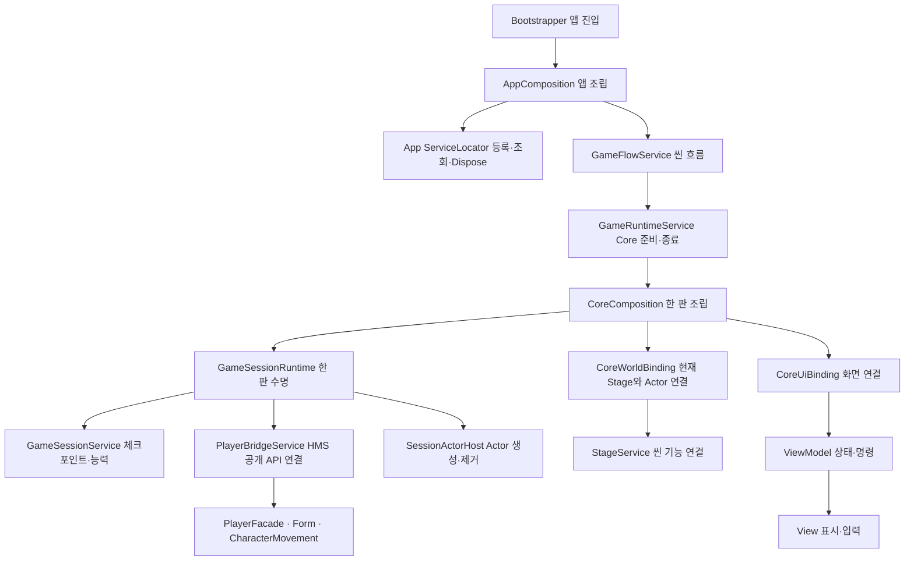

# 현재 구조와 V1.5 차이

2026-10-10, branch `feature/core/systems`, 시작 HEAD `cd528ce`. 첨부 DOCX의 SHA256은 `d5698cbc3e50bcb1a4ea8c4f31eae325b43af7221bbcc97a150fdb8b28aa8ebe`다. XML의 문단·run 색·취소선·삭제 텍스트를 보존하여 읽었다. P번호는 추출 문단 식별자이며 Word 페이지 번호가 아니다. 활성 본문과 후반의 버전별 변경 이력을 구별했다.

조사 대상은 Core C#174개(SYM128/HMS41/공용5), 텍스트 직렬화 자산161개, 소유 씬12개다. 정규식·GUID 검색은 컴파일/실행 결과가 아니다. 이 READY에서는 제품 코드/씬/prefab을 변경하지 않았으며 Unity 실행·Play·빌드·Git 작업도 하지 않았다.

## 현재 구조를 먼저 설명

App는 게임 실행 전체, Core 씬 인스턴스는 첫 로드 뒤 유지, 한 판 scope는 Title 복귀 때 해제/다음 새 게임에서 재생성, Actor는 사망 복귀 때 교체, 활성 Stage 연결은 Stage 전환마다 교체된다. 이 수명을 모두 하나로 합치면 Title 복귀/Retry/Stage 전환의 해제 대상이 섞인다. 같은 수명에서 참조와 Bind만 중복하는 래퍼는 제거하고 이 실제 수명 경계는 유지한다.

## 서비스 로케이터와 조립자가 둘 다 있는 이유

현재 ServiceLocator는 `Type → instance` 등록/조회, 부모 scope fallback, 중복 등록 거절과 소유 서비스의 역순 Dispose를 처리한다. “게임의 모든 구체 서비스를 생성하는 최상위 신”으로 구현되어 있지 않다. AppComposition/CoreComposition은 Camera·UI·Audio 같은 Unity 실물과 서비스 생성 순서를 알고 실제 의존을 연결한다. 소비자에게는 작은 계약을 직접 주입한다.

조립자가 매 호출을 받아 Locator로 다시 전달하기만 한다면 필요성을 의심할 수 있다. 현재 조립자는 생성/초기화/부분 실패 해제/한 판 재연결을 수행하므로 실제 역할이 있다. Locator에 그 생성·씬 탐색·UI·물리까지 넣으면 사용자가 우려한 거대 전역 가변 객체가 된다. configuration/사용 분리를 설명하는 [Fowler의 원문](https://martinfowler.com/articles/injection.html)과도 일치하는 조합이다. 이 자료가 프로젝트의 권위 기획을 대체하지는 않는다.

GameUiRoot/GlobalUiRoot/UIScaleTween, 범용 이벤트 버스, EnemyActor와 같은 수명의 상태·접촉 전달은 별도로 정리한다. `CoroutineOperationRunner`는 중첩 iterator 예외/finally, `SessionShutdownOperation`은 실패해도 Dispose/Release하는 책임이 있어서 단순 중계로 삭제하지 않는다.

## 명세 차이와 누락·부분 구현

| 항목 | V1.5/직접 요구 | 현재 소스 근거 | 영향/처리 |
|---|---|---|---|
| 현재 전체 흐름 | 응집형 Stage 하나에서 게임 진행1회. 이후 연결해도 독립 씬 진입 유지 | Prototype에 Chase/포포/CP/장치가 함께 배치됨. 등록 Stage들 간 자동 전환 호출 없음 | 현재 NewGame→Prototype→Ending→Title를 명세. 자동 Stage 1→2→3을 이번에 추가하지 않음 |
| 체크포인트 | P0336–343 위치·조각·해금 동시 저장/복원 | SessionContracts.CheckpointSnapshot은 Position/Fragments만; GameSessionService.CaptureCheckpoint/ResetStageUnlocks | 해금 마스크 추가, 현재Stage 출처 기반 일괄 재잠금 제거. 저장 항목을 세계 상태로 확장하지 않음 |
| 동일 CP | 마지막 CP 재접촉은 갱신 안 함 | GameSessionRuntime의 string lastContactCheckpointId; retry에서 초기화 | Marker 객체 참조 기반 마지막 물리 CP를 한 판 동안 유지. 재등장 직후 같은 CP 재저장 방지 |
| 추격 전 저장 | P0338/P0386 저장 성공 후 추격·퇴로 | StageService.TryStartChaseAtBodyPosition은 시작/문 닫기만 함 | 전신 통과/문 안전/시작 가능 확인→원자 저장→추격·차단. 실패 시 시작하지 않음 |
| CP 구성 | V1.5는 실제 새 CP 접촉을 정의 | StageService가 정확히 시작/끝2개만 검증, Runtime이 pair 외 거절 | 현재 시작/끝 배치는 유지하되 새 명세에 없는 “오직2개” 강제와 pair 전용 저장 API 제거 |
| 능력과 안내 대화 | P0237 재해금, P0425 완료 Code 재실행 금지 | CoreWorldBinding.ResetNotices가 재잠금 안내의 완료 기록 제거 | 해금/HUD는 CP 마스크 복원. 완료/Skip한 안내 기록 유지, Cancelled만 재시작 가능 |
| Inspector 위치 | 실제 Transform/Marker 연결 | Stage의 Vector3[] 경로, Marker bodyOffset, 플랫폼 travelOffset, 적 순찰 거리 | 작성 목표/위치 리터럴을 실물 연결로 교체. 계산 결과·저장 Vector3는 유지 가능 |
| Inspector 키 | 인간이 대상 키를 암기하지 않음 | Stage/CP/value/Zone Id/씬 Path/Audio ID 입력 | SceneAsset·Marker·종류별 typed 참조·검증된 테이블 선택으로 전환 |
| 씬 계층 | 씬 관리자의 자식으로 월드 배치 금지 | 아래 씬 루트 조사; AppComposition.IsChildOf 검증 | 씬 소속 조회/명시 참조로 먼저 변경 후 월드 루트 분리. 부모 존재를 연결 성공 조건으로 사용하지 않음 |
| 재준비 누락 위험 | 분리된 모든 기믹 복구 | StageService.ResetForRetry, HasAbilityUnlock/NoticeCodes 등 GetComponentsInChildren | 같은 씬의 비활성 root까지 조회하고 활성 Stage만 Actor 연결. 다른 Stage 객체를 같이 reset하지 않음 |
| 눈물 이동 | Render+Trigger 실제 Root 이동 | TearFragment.Update가 presentationVisual만 bob/rotate | pickupRoot 전체를 이동. 동일 원본의 pose/활성/센서를 retry에 복구 |
| 발판 몸 높이 판정 | P0291 ≥1/4 깊은 끼임 사망 | PeriodicPlatform.ComputePenetration out distance를 body height*0.25와 비교 | 최소 분리 거리와 몸 높이 침투를 분리. 실제 수직 침투/현재 몸 높이로 판정 |
| 얕은 끼임 | <1/4 정상 착지 | PeriodicPlatform의 `continue`만 있음 | 실제 Body 보정 후 지지 접촉/접지가 정상적으로 성립. 불필요 피해·사망 없음 |
| 움직이는 주기 발판 | 등장 순간 및 이동 중 겹침 | ResolveMaterialization은 표시 phase 진입에만 실행 | 실제 이동/접촉 변화에서도 분류. 정상 상부 착지 제외 |
| 깊은 끼임 표현 | 몸체+Collider 위로 밀어내며 사망 | DOMove 대상이 visual/껍질 visual, 몸체 그대로 | 실제 HMS 물리 명령과 조정된 몸체 이동. 피격 clip 길이를 0으로 읽어 이동까지 사라지지 않게 분리 |
| 껍질 끼임 | 소유자 사망 금지, 껍질만 분리 | PlayerDebris.Owner에서 PlayerFacade를 찾아 ForceDeath | Player/OwnedDebris 별도 분기. HP·폼·소유는 보존 |
| 껍질 낙사 | 현재 Player 위치로 반환 | StageTrigger는 현재 PlayerFacade만 수락; ActorFallGuard는 Player만 Y검사 | 실제 데드존 Volume에서 OwnedDebris 반환. 새 생성·Q 회수와 구별 |
| 주기/경고 수치 | P0285/286 사람이 조절 | Periodic.OnValidate가5/2/3 강제, 실행 %10 및 phase 상수 | 입력 수치로 실제 phase 길이 계산. Shattered/왕복 대기 등 표시 값과 실행도 맞춤 |
| 장치·플랫폼 공간 | 충돌과 외형이 같이 이동 | KinematicPlatformMotion이 자식 Rigidbody 이동; Root의 형제 Render는 안 따라감 | 제작 계약에 actual Body 아래 Render 및 목표 Point의 고정 부모를 명시 |
| 일반 적 순찰 | X/Y 작성 지점, 끝에서 즉시 반전 | 수치 patrolDistance/manualLower/Upper, StateMachine/Motor | 실제 patrolStart/end 드래그; 상태 Actor, 접촉 Sensor, 지형 Motor |
| 공통 넉백 | P0149 모든 피해원 같은 수평/상향 세기 | 적 Definition 기존 자산10, DamageFloor 기본3 및 normalized+up | Bridge 공통 설정/방향 규칙으로 단일화. source별 수치와 중복 계산 삭제 |
| Q 전환 | 성공 즉시 Collider/껍질, 성공 시1초 | Bridge accepted 타이머·HMS Form API 있음 | 정상3/Small2 점프·Root 배율 유지·좁은 복귀 실패 등을 정적/비 Play 검사와 사람 확인으로 구분 |
| 눈물 E | 5조각/Root 중심3m/직접 몸체 차폐/2초 누적 | Bridge target validation + HMS TearSkill API 있음 | 정확한 hurt Collider와 선분 차폐 유지; 독립 Trigger를 일괄 무시하지 않음 |
| 대화 Skip | 전체 Code 완료로 종료 | Service.SkipAll 있음, View/VM 버튼 연결 없음 | Skip button/command/CanSkip 연결. Completed+Skipped 장부·최종 대화 종료에 사용 |
| 포포 종료 | 완료/Skip 뒤 Ending, 동시 포획 우선 | StageService 최종대화 callback이 Completed만 수락 | Cancelled/낡은Actor 거절; Completed/Skipped만 한 번 Escape |
| 표현 우선순위 | P0201 Interact>Tear>Form | HMS PlayerAnimationPlayback Interact=2/Tear=3 | 허용된2파일 최소 수정: Interact=4, 관련 설명 교정. enum/기타 HMS 변경 없음 |
| 실제 아트/애니메이션 | 실제 리소스 연결 후 사람이 확인 | 임시 UI/모델과 일부 미연결 표현이 존재 | 코드 정합성과 실제 clip/리소스 재생을 구분. 자산을 자동 생성해 완료로 대체하지 않음 |
| 반복 제작기 | 사람의 prefab 제작 | 자동 생성/Repair Editor12개 | 유효 검증/빌드 목록을 이관한 뒤 삭제. 도구를 실행하여 사람 prefab 덮어쓰기 금지 |
| 보호 코드/PR | HMS 이전 변경 정확한 공유 | 6f2a386/5d1770d 두 관련 변경 | 상세 변경 기록. 이번 PR 생성 없음. 추가 수정은 허용된2파일 한정 |

`Physics.ComputePenetration`의 distance는 두 Collider를 분리하는 최소 이동 거리다. 이것만으로 “몸 높이 중 발판 내부에 들어간 비율”을 증명하지 못한다. API 의미는 [Unity 공식 문서](https://docs.unity3d.com/6000.0/Documentation/ScriptReference/Physics.ComputePenetration.html)에서 확인했다. 실제 충돌 여부 검사로는 재사용하되 severity의 단위/기준을 구분한다.

## 실제 씬 관리자 하위 배치 조사

| 씬 | 현재 관리자 루트 | 직접 자식 수 | 처리 |
|---|---|---:|---|
| Architecture/01_Bootstrapper | BootstrapRoot | 4 | 앱 담당/출력/UI/Audio 독립 루트와 참조 |
| Architecture/03_InGameCore | InGameCoreRoot | 6 | Core 담당/ActorHost/UI/리그 독립 루트 |
| Architecture/Prototype/1_Stage | Prototype_1_Stage | 63 | 월드 오브젝트 독립 루트 |
| Architecture/Stages/03_1_Stage | Stage 루트 | 26 | 현재 미등록 과거 씬. 제거하지 않고 소유 씬 계층만 필요 시 이관 |
| Architecture/Stages/03_2_Stage | Stage 루트 | 23 | 월드 오브젝트 독립 루트 |
| Architecture/Stages/03_3_Stage | Stage 루트 | 20 | 월드 오브젝트 독립 루트 |

기타 소유 씬6개와 prefab instance의 부모도 `evidence/scene-hierarchy-inventory.json`에 보존했다. PlayerRoot의 ActorBody/Visual 등 **완성 prefab 내부 계층은 관리자 하위 월드 배치 문제로 세지 않는다.** 이름·개수만 보고 보호 prefab을 unpack하거나 원본 Apply하지 않는다. 씬 override 가능한 배치는 worldPositionStays로 옮기고 실제 월드 pose/scale/parent 참조를 대조한다.

## 유지되는 유효 구조와 별도 확인 범위

일반 적 Idle/Patrol/Stunned, HMS HP/폼/무게/외력, Core/Stage 최초 로드 뒤 유지, Options/메모의 자기 토큰, 대화·로그의 자체 월드 진행, MVVM 및 렌더러 순수 표현은 유지할 요구다. 단지 클래스가 많다는 이유로 서로 다른 규칙과 수명을 합치지 않는다. 개별 판단은 [스크립트 표](<스크립트 필요성 및 삭제 계획.md>)에 있다.

원본 DOCX 수정·Word 렌더 검수·전체 실행 QA·FunQA·실제 전체 플레이·최종 리소스 재생은 이번 READY에서 수행하지 않았다. 이 분석의 “현재”는 소스/저장 자산의 사실이며 사용자가 보고한 실제 증상을 자동으로 재현했다고 주장하지 않는다.
